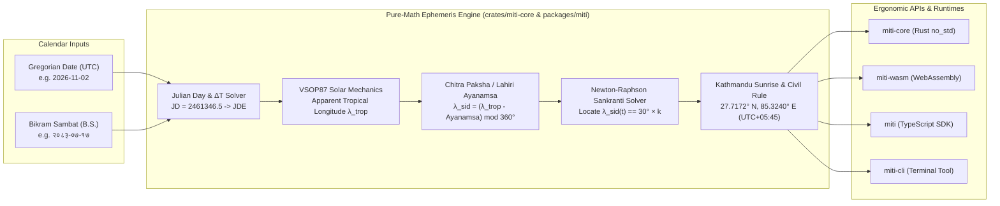

# Miti (मिति) 🪐📅

**High-precision, pure-math Bikram Sambat (B.S.) astronomical date engine and sidereal calendar ecosystem written in Rust (compiled to WebAssembly) with a zero-lookup-table TypeScript SDK and CLI.**

[](./LICENSE)
[](./.github/workflows/ci.yml)
[](./crates/miti-core/Cargo.toml)
[](./packages/miti/package.json)
[](./CONTRIBUTING.md)

---

## The Problem `Miti` Solves: Why Static Lookup Tables Fail

Nepal's official civil calendar — **Bikram Sambat (विक्रम संवत् / B.S.)** — is not an arithmetic leap-year calendar like the Gregorian calendar. It is a **true astronomical sidereal solar calendar**:

1. **Variable 29-to-32-Day Months Driven by Keplerian Orbital Mechanics:**
   - Each Bikram Sambat month begins after **Sankranti (संक्रान्ति)** — the exact astronomical instant the Sun's sidereal (*Nirayana*) longitude crosses a $30^\circ$ zodiac boundary (**Rashi / राशि**: $0^\circ$ *Mesha/Aries* = **Baisakh**, $30^\circ$ *Vrishabha/Taurus* = **Jestha**, …, $180^\circ$ *Tula/Libra* = **Kartik**, …, $330^\circ$ *Meena/Pisces* = **Chaitra**).
   - Because Earth's orbit is elliptical (Kepler's Second Law), Earth travels fastest near perihelion (January / *Poush–Magh*, taking ~29.3 days per $30^\circ$) and slowest near aphelion (July / *Asar–Shrawan*, taking ~31.6 days per $30^\circ$). Consequently, B.S. month lengths fluctuate dynamically between **29, 30, 31, and 32 days** from year to year.
2. **The Brittle Lookup-Table Status Quo:**
   - Virtually every existing open-source Bikram Sambat library (`bikram-sambat-js`, `nepali-date`, etc.) relies on **hardcoded JSON or array lookup tables** (`{ 2080: [31, 32, 31, ...], 2081: [...] }`).
   - **Hard Expiration Dates:** Static tables throw runtime out-of-range errors as soon as an application queries a future mortgage, bond maturity, or birth date outside the hardcoded array (typically B.S. 2000–2090).
   - **Zero Historical & Astronomical Context:** Static arrays cannot compute historical dates, cannot report the exact *Sankranti* transit timestamp, and ship kilobytes of opaque magic numbers instead of the underlying celestial mechanics.
3. **The `Miti` Algorithmic Solution:**
   - `Miti` eliminates static year-length JSON files by solving the astronomical pipeline from first principles:
     $$\text{Gregorian UTC} \longrightarrow \text{JDN / JDE }(\Delta T) \longrightarrow \lambda_{\text{tropical}}\text{ (VSOP87)} \longrightarrow \lambda_{\text{sidereal}}\text{ (Lahiri Ayanamsa)} \longrightarrow \text{Newton-Raphson Sankranti} \longrightarrow \text{Kathmandu Civil Gate}$$
   - Calibrated to **Kathmandu topocentric coordinates (`27.7172° N, 85.3240° E`, Nepal Standard Time `UTC+05:45`)**, `Miti` computes deterministic Bikram Sambat dates, month lengths, and *Sankranti* transit instants across arbitrary past and future centuries.

---

## Conceptual Architecture & Mathematical Pipeline



```text
┌──────────────────────────────────────────────────────────────────────────────┐
│                        MITI (मिति) ASTRONOMICAL PIPELINE                     │
├──────────────────────────────────────────────────────────────────────────────┤
│  1. JDN / JDE        : Gregorian UTC  ──► Continuous Julian Ephemeris Day    │
│  2. VSOP87 Solar     : L0 + Equation of Center C + Planetary Perturbations   │
│  3. Lahiri Ayanamsa  : λ_sidereal = (λ_tropical - Ayanamsa(T)) mod 360°      │
│  4. Sankranti Solver : Newton-Raphson root-finder for λ_sid(JD) = (m-1)×30°  │
│  5. Civil Boundary   : Kathmandu (27.7172°N, 85.3240°E) NST Gate 1 Mapping   │
└──────────────────────────────────────────────────────────────────────────────┘
```

---

## Repository Structure

```text
Miti/
├── Cargo.toml                                            # Rust Cargo workspace manifest (miti-core, miti-wasm)
├── package.json                                          # Node/TypeScript workspace manifest (miti, miti-cli)
├── pnpm-workspace.yaml                                   # pnpm workspace definition
├── tsconfig.base.json                                    # Shared strict TypeScript configuration
├── crates/
│   ├── miti-core/                                        # Pure-math Rust astronomical & Bikram Sambat engine
│   │   ├── Cargo.toml
│   │   └── src/
│   │       ├── lib.rs                                    # Public Rust API & unit test suite
│   │       ├── jdn.rs                                    # Gregorian <-> Julian Day (JDN) & ΔT (TT - UTC)
│   │       ├── vsop87.rs                                 # VSOP87 apparent tropical solar longitude & EOT
│   │       ├── ayanamsa.rs                               # Chitra Paksha / Lahiri Ayanamsa precession model
│   │       ├── sunrise.rs                                # Kathmandu (27.7172° N, 85.3240° E) sunrise & civil rule
│   │       └── sankranti.rs                              # Newton-Raphson Rashi transit solver & B.S. converter
│   └── miti-wasm/                                        # WebAssembly bindings (wasm-bindgen)
│       ├── Cargo.toml
│       └── src/
│           └── lib.rs                                    # JS/WASM bridge for MitiDate & Sankranti queries
├── packages/
│   ├── miti/                                             # TypeScript SDK with Temporal/Day.js-style API
│   │   ├── package.json
│   │   ├── tsconfig.json
│   │   ├── src/
│   │   │   ├── astronomy.ts                              # Pure-math VSOP87, Ayanamsa & Kathmandu sunrise engine
│   │   │   └── index.ts                                  # Miti, MitiDate, SankrantiEvent & Devanagari formatter
│   │   └── test/
│   │       └── miti.test.ts                              # Vitest astronomical & B.S. 2000–2090 verification suite
│   └── miti-cli/                                         # Fast terminal CLI (`miti conv`, `miti year`, `miti today`)
│       ├── package.json
│       ├── tsconfig.json
│       └── src/
│           └── index.ts                                  # CLI entrypoint
├── .github/
│   ├── workflows/
│   │   └── ci.yml                                        # Dual Rust (cargo test) + TypeScript (Vitest) CI pipeline
│   └── ISSUE_TEMPLATE/
│       ├── 01-math-refraction-topocentric-sunrise.md     # Issue: 1,400m Kathmandu refraction & horizon dip
│       ├── 02-rust-compact-panchanga-delta-patch.md      # Issue: Bit-packed historical Panchanga delta layer
│       ├── 03-astronomy-elp2000-lunar-tithi-engine.md    # Issue: ELP-2000 lunar longitude & 12° Tithi solver
│       └── 04-typescript-temporal-intl-calendar-adapter.md # Issue: TC39 Temporal calendar adapter
├── ROADMAP.md                                            # 115+ hour multi-phase post-MVP engineering roadmap
├── CONTRIBUTING.md                                       # Contributor & local development guide
└── LICENSE                                               # MIT License
```

---

## Quick-Start Guide

### 1. Clone, Install & Build

```bash
git clone https://github.com/adhikari18/Miti.git
cd Miti
npm install
npm run build
npm test
```

### 2. TypeScript / JavaScript SDK Usage (`packages/miti`)

```typescript
import { Miti } from 'miti';

// 1. Convert Gregorian Date (UTC) -> Bikram Sambat (B.S.)
const mitiDate = Miti.fromGregorian('2026-11-02');

console.log(mitiDate.format('YYYY-MM-DD'));
// => "2083-07-17"

console.log(mitiDate.format('YYYY-MM-DD', { locale: 'ne' }));
// => "२०८३-०७-१७"

console.log(mitiDate.format('YYYY MMMM DD, dddd', { locale: 'ne' }));
// => "२०८३ कार्तिक १७, सोमबार"

// 2. Convert Bikram Sambat -> Gregorian Date
const gregDate = Miti.fromBikramSambat('२०८३-०७-१७').toGregorian();
console.log(gregDate.toISOString().slice(0, 10));
// => "2026-11-02"

// 3. Inspect exact astronomical Sankranti (solar Rashi transit)
const sankranti = mitiDate.sankranti();
console.log(sankranti);
// {
//   bsYear: 2083,
//   bsMonth: 7,
//   rashiNameEn: 'Tula (Libra)',
//   rashiNameNe: 'तुला',
//   targetLongitudeDeg: 180,
//   transitIsoUtc: '2026-10-17T...',
//   ayanamsaDeg: 24.4265...
// }

// 4. Compute all 12 month lengths (29..32 days) dynamically for any B.S. year
console.log(Miti.getMonthLengths(2083));
// => [31, 31, 32, 31, 31, 31, 30, 29, 30, 29, 30, 30] (365 days)
```

### 3. Terminal CLI Usage (`packages/miti-cli`)

```bash
# Convert a Gregorian date to Bikram Sambat with Sankranti telemetry
npm run cli -- conv 2026-11-02

# Convert a Bikram Sambat date (ASCII or Devanagari) to Gregorian
npm run cli -- bs २०८३-०७-१७

# Display today's Bikram Sambat date in Kathmandu (NST)
npm run cli -- today

# Print the full 12-month astronomical Sankranti ephemeris table for B.S. 2083
npm run cli -- year 2083

# Run the 91-year (B.S. 2000–2090) astronomical verification benchmark
npm run cli -- benchmark
```

### 4. Rust Core Usage (`crates/miti-core`)

```rust
use miti_core::{gregorian_to_miti, miti_to_gregorian, GregorianDate};

let greg = GregorianDate::new(2026, 11, 2);
let bs = gregorian_to_miti(greg);
assert_eq!((bs.year, bs.month, bs.day), (2083, 7, 17));

let round_trip = miti_to_gregorian(2083, 7, 17).unwrap();
assert_eq!(round_trip, greg);
```

---

## Post-MVP Engineering Roadmap (115+ Hours Planned)

Our post-MVP roadmap in **[`ROADMAP.md`](./ROADMAP.md)** is organized into 5 concrete phases (3–6 hours per work item):

- **Phase 1: Historical Calibration, Topocentric Refraction & Anomaly Patch Layer (`~20 hrs`)** — $1,400\text{ m}$ Kathmandu horizon dip/refraction, classical *Surya Siddhanta* vs. *Drik* mode switch, and a `<256-byte` bit-packed delta patch table.
- **Phase 2: Lunar Dynamics, *Tithi* & *Panchanga* Five-Limb Engine (`~30 hrs`)** — Truncated ELP-2000 lunar ephemeris, $12^\circ$ *Tithi* solver, *Nakshatra/Yoga/Karana*, and *Adhika Masa* (lunar leap month) detection.
- **Phase 3: Deterministic Festival & Public Holiday Predictor (`~25 hrs`)** — Algorithmic computation of *Dashain*, *Tihar (Laxmi Puja / Bhai Tika)*, *Maha Shivaratri*, *Buddha Jayanti*, and *Maghe Sankranti* directly from celestial coordinates.
- **Phase 4: Developer Ecosystem, WASM Packaging & Cross-Platform Ergonomics (`~20 hrs`)** — TC39 `Temporal.CalendarProtocol` adapter, date range arithmetic, `wasm-pack` dual bundles, and an interactive *Patro* web explorer.
- **Phase 5: Extended Astronomical Precision & Multi-Location Support (`~20 hrs`)** — 150-term VSOP87D series, configurable diaspora observer coordinates, Himalayan eclipse predictor, and 500-year property-based fuzzing.

---

## Contributing & Seeded Issues

Check out our ready-to-pick-up contributor tasks in [`.github/ISSUE_TEMPLATE/`](./.github/ISSUE_TEMPLATE/):
1. **`math` / `astronomy`:** [High-Altitude Atmospheric Refraction & Dip Correction for Kathmandu Sunrise (`1,400m`)](./.github/ISSUE_TEMPLATE/01-math-refraction-topocentric-sunrise.md)
2. **`rust` / `math`:** [Bit-Packed Historical Panchanga Delta-Override Layer (`no_std`)](./.github/ISSUE_TEMPLATE/02-rust-compact-panchanga-delta-patch.md)
3. **`astronomy` / `rust`:** [ELP-2000 Lunar Ephemeris, Tithi (`12°` Elongation) & Adhika Masa Solver](./.github/ISSUE_TEMPLATE/03-astronomy-elp2000-lunar-tithi-engine.md)
4. **`typescript` / `good first issue`:** [ECMAScript `Temporal.CalendarProtocol` & `Intl` Adapter](./.github/ISSUE_TEMPLATE/04-typescript-temporal-intl-calendar-adapter.md)

See [`CONTRIBUTING.md`](./CONTRIBUTING.md) for development guidelines.

---

## License

Released under the [MIT License](./LICENSE). Copyright (c) 2026 Ashok Adhikari.

